# tberry

**A standalone [MeshCore](https://github.com/meshcore-dev/MeshCore) messenger for the LilyGO T-Deck Plus.**
Send and receive mesh messages with the built-in keyboard and touch screen, with no phone and no
app. It speaks standard MeshCore, so it works alongside the official apps and any other MeshCore
node.

<p>
  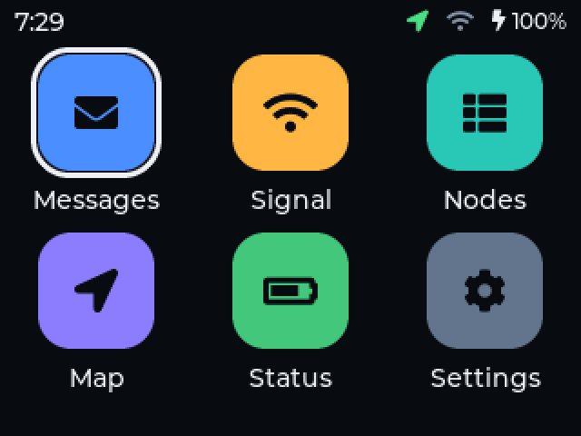
  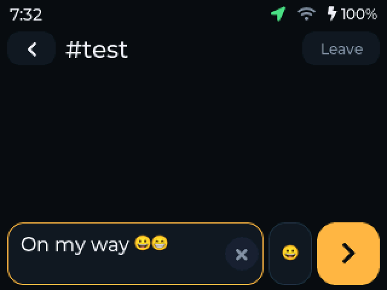
  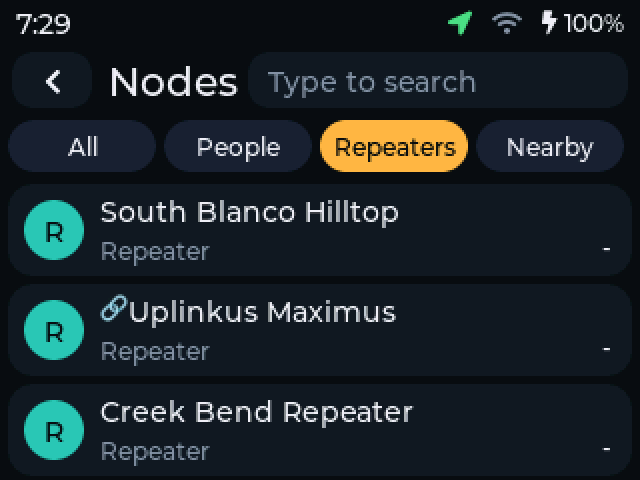
  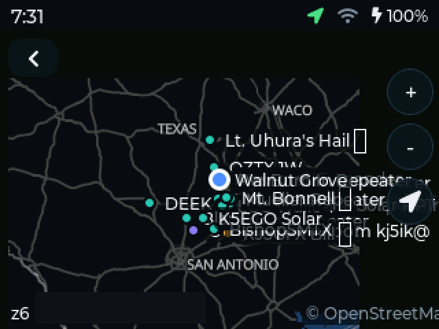
</p>

The goal is a device a non-technical person can pick up and use, with the technical controls (radio
parameters, behind a PIN) still within reach.

> **Status: working prototype.** It is used daily on real hardware, but it is young. Expect rough
> edges, and read [Known limitations](#known-limitations) before relying on it. This is an
> independent project and is not affiliated with MeshCore or LilyGO.

## Features

**Messaging**
- Direct messages with delivery ticks and round-trip time, and channels. The Public channel is
  built in, and **hashtag channels** (`#test`, `#yourtown`, ...) can be joined and left on the device.
- Replies use the common `@[Name]` convention: tap a message to reply, hold it for details (route,
  hops, SNR, repeater path, timing). Mentions of you are highlighted and can chime.
- Reactions from other clients are shown as badges on the message they belong to.
- Emoji, drawn from the SD card, with an on-device picker. Unsent text is kept when the screen locks.

**Network**
- **Nodes:** everyone heard, filterable (All, People, Repeaters, Nearby) and searchable by typing.
  Tap a node for signal, hops, distance and direction, then message it, show it on the map or run
  a range test.
- **Signal:** a one-tap range test to a person: round-trip time, hops, RSSI and SNR, logged to the SD card.
- **Map:** an offline map from the SD card with your position, nodes that share theirs, and "where did
  this message come from".

**Device**
- **Status:** battery, uptime, packets, airtime, storage, and GPS detail (fix, satellites, accuracy).
- **Settings:** name, time zone, brightness, volume, channel sounds, screen timeout, screen off, GPS,
  WiFi (for updates only), and a PIN-protected **Advanced** area for radio parameters.
- **First-boot setup:** a four-screen guide for a new device.
- **Battery care:** the screen dims and then switches off after the clock shows; GPS can be switched
  off; a battery log is kept on the card for measuring drain.
- **Updates over the air** from this repository's releases, signed and verified before install.
- **Privacy:** the device does not broadcast its position. WiFi is only on while updating.

<details>
<summary>More screenshots</summary>
<p>
  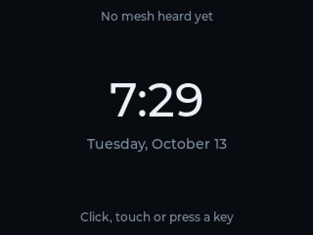
  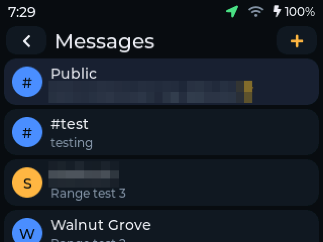
  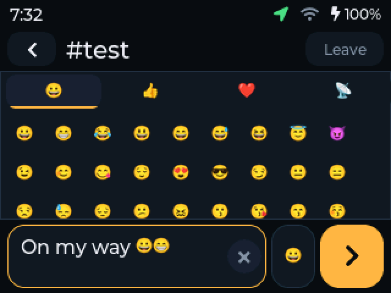
  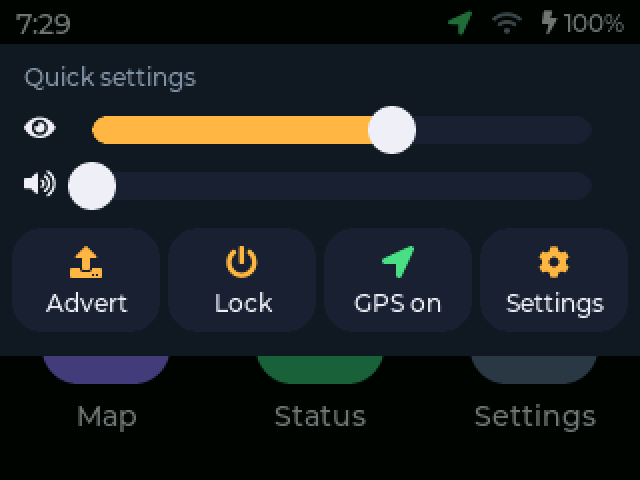
  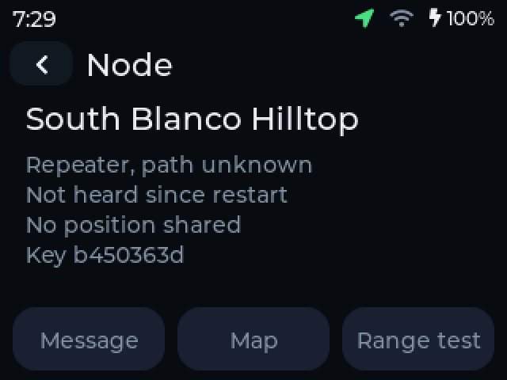
  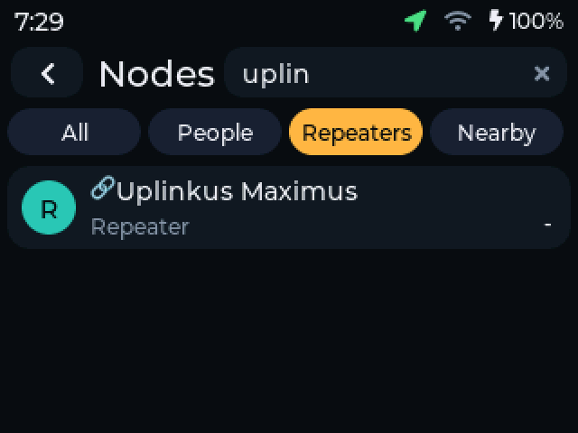
  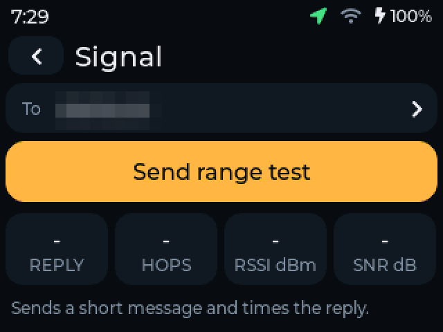
  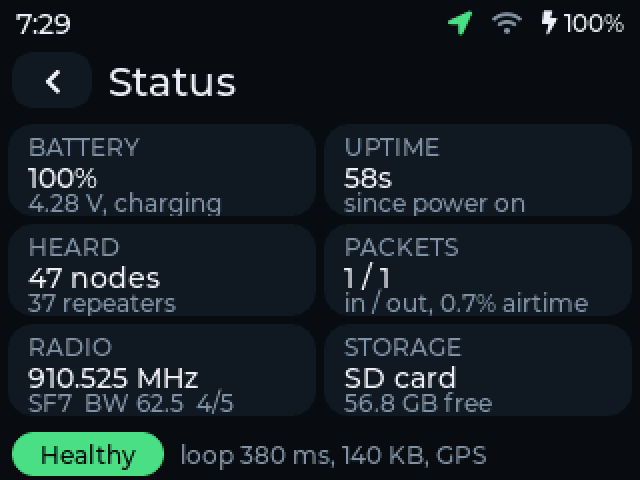
  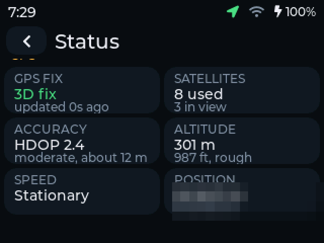
  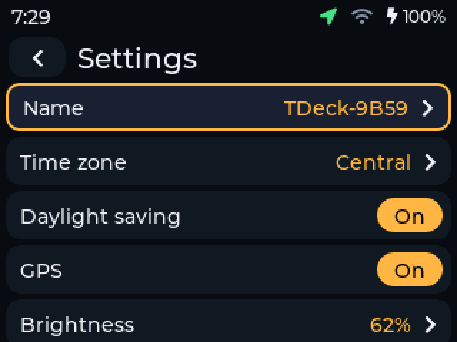
  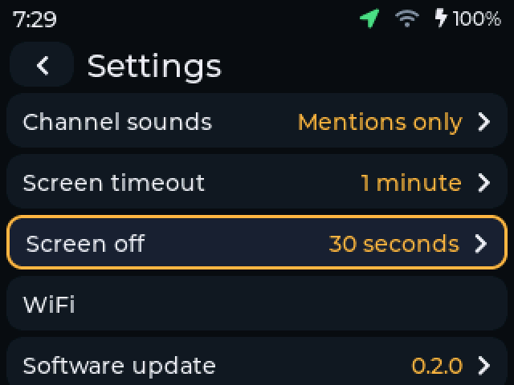
  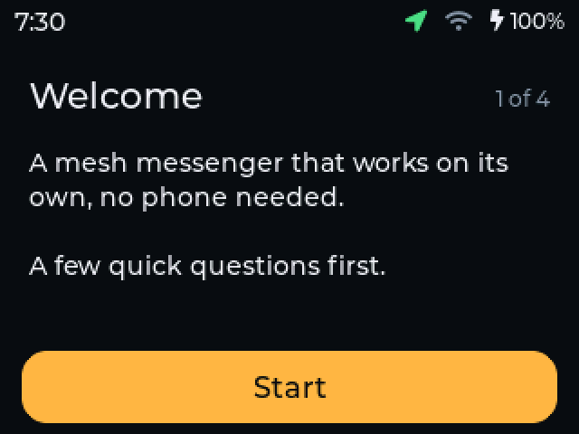
</p>
</details>

## What you need

- A **LilyGO T-Deck Plus** (ESP32-S3, 320x240 touch screen, keyboard, SX1262 radio, GPS).
- A **microSD card** (FAT32). Optional, but needed for message history, the map and emoji.
- A computer with [PlatformIO](https://platformio.org/) and a USB cable, for the first install.

The default radio settings are the US/Canada MeshCore preset (910.525 MHz, 62.5 kHz, SF7, CR5).
Change them under Settings, Advanced if your region uses something else, and make sure you operate
within your local regulations.

## Install

```sh
git clone --recurse-submodules https://github.com/tonyperkins/tberry.git
cd tberry/tdeck-os
pio run -e tdeck                                          # build
pio run -e tdeck -t upload --upload-port /dev/ttyACM0     # flash
```

On first start the device walks you through naming it and choosing a time zone. After that,
**Settings, WiFi** and **Settings, Software update** keep it current without a cable.

### Using it

| Gesture or key | Does |
|---|---|
| Swipe in from the left edge | Back |
| Swipe up from the bottom edge | Home |
| Swipe down from the top edge | Quick settings: brightness, volume, advert, lock, GPS |
| Trackball | Move, scroll, left/right changes filters; click selects; long press goes Home |
| Type in a conversation | Writes the message; Enter sends; Backspace on an empty box goes back |
| Type on the Nodes page | Searches names and key prefixes |
| `+` / `-` / `c` on the map | Zoom in, zoom out, centre on you |

## SD card

FAT32. Everything is optional.

```
/tdos/msgs/<key>.log    message history, one append-only file per conversation
/tdos/signal.csv        range-test results
/tdos/batt.csv          battery log (every 5 minutes)
/tdos/boot.log          why the device restarted, one line per start
/maps/<z>/<x>/<y>.png   map tiles       (built with tdeck-maps)
/emoji/<codepoint>.bin  emoji images    (built with tdeck-os/tools/make_emoji_pack.py)
/emoji/pack.bin         the same, bundled for fast loading (tdeck-os/tools/pack_emoji.py)
```

Copying tens of thousands of map tiles is much faster if the card is mounted without the `flush`
option (`mount -o noatime,async`).

### Map tiles

[`tdeck-maps`](tdeck-maps) builds dark, low-colour tiles for a region from OpenStreetMap data and
writes them in the layout above. See its README.

### Emoji pack

`tdeck-os/tools/make_emoji_pack.py` converts the Noto emoji into small image files. Copy the output
folder to the card as `/emoji/`, then bundle it:

```sh
python3 tdeck-os/tools/pack_emoji.py emoji emoji/pack.bin
```

Looking up one file among 1,400 on a FAT card takes tens of milliseconds, which made the picker
slow. With `pack.bin` the firmware reads everything into memory once at start-up and lookups are
instant. Without it, emoji still work, just slower.

## Updating over the air

The device fetches `releases/latest/download/manifest.json` from this repository's GitHub releases,
shows the version on offer, and installs it when asked. Nothing is installed unless its Ed25519
signature, size and SHA-256 all match; the public key is compiled into the firmware.

To publish a release (maintainers): raise `TDOS_VERSION` and `TDOS_BUILD` in
`tdeck-os/include/version.h`, then run `tdeck-os/tools/publish_release.sh "notes"`. The signing key
lives outside the repository at `~/.config/tberry/signing.key`; keep a backup. Without it, devices can
only be updated over USB.

## Debug build and remote control

`pio run -e tdeck-remote` builds the same firmware with a serial remote control compiled in. With it,
`tdeck-os/tools/remote.py` can tap, swipe, type, move the trackball and save screenshots over USB, for
example:

```sh
python3 tdeck-os/tools/remote.py "tap 160 120" "wait 500" "shot home.png"
```

The screenshots above were taken this way. The normal build leaves it out, About shows "debug"
when it is present, and `tdeck-os/tools/release.sh` builds the release image and checks that no
debug code is in it.

## Repository layout

| Folder | What |
|---|---|
| [`tdeck-os/`](tdeck-os) | the firmware (PlatformIO, Arduino, LVGL) |
| [`tdeck-os/docs/backlog/`](tdeck-os/docs/backlog) | design notes and tickets, one file per feature |
| [`tdeck-maps/`](tdeck-maps) | builds the offline map tiles for the SD card |
| [`tdeck-hello/`](tdeck-hello) | the small hardware bring-up firmware (display, touch, keyboard, radio) |

MeshCore is included as a git submodule, unmodified and pinned to a tested commit. Update it
deliberately, not with a plain `git pull`.

## Developer notes

Things that cost time to find out:

- **Pin the platform** (`espressif32@6.12.0`). An unpinned `espressif32` resolves to a newer SDK that
  lacks what MeshCore needs. If esptool fails with `No module named 'intelhex'`, run
  `pipx inject platformio intelhex`.
- **Share the display's SPI object.** The radio and SD card must use `TFT_eSPI::getSPIinstance()`; the
  global `SPI` re-routes the pins and blanks the display.
- **Never block the main loop**, and do not call `Serial.setTxTimeoutMs(0)`: on the ESP32-S3's USB
  serial it makes a write wait forever when nobody is reading, which looks exactly like a frozen
  device. Logging goes through `logf()` in `main.cpp`, which only writes when there is room.
- **LVGL's memory pool is small** (about 70 KB free). Share styles between many objects instead of
  giving each its own, and free screens you are not showing.
- The backlight is a single-wire pulse-counting driver, not PWM.

## Known limitations

- Reactions can be shown but not sent: the code that identifies the target message is not understood yet.
- Joining private (key-based) channels is not supported; hashtag channels are.
- No room-server login.
- No real-time clock chip: the clock is blank after power-up until GPS or a mesh advert provides the time.
- The font covers Latin-1 and Latin Extended-A; other scripts show as `?`.
- Only the US/Canada radio preset has been tested on air.
- No automatic rollback: a signed image that crashes at start needs a USB reflash.
- The keyboard backlight does not light yet.

## Contributing

Issues and pull requests are welcome. Before sending a change, build the release image with
`tdeck-os/tools/release.sh`. For UI changes, include a screenshot taken with the remote tool.

## Licence and credits

MIT, see [LICENSE](LICENSE). This builds on [MeshCore](https://github.com/meshcore-dev/MeshCore) (MIT),
[LVGL](https://lvgl.io/) and the Arduino-ESP32 framework, among others. Third-party components and
the data used by the map and emoji tooling are listed with their licences in
[THIRD_PARTY_NOTICES.md](THIRD_PARTY_NOTICES.md). Map data is (c) OpenStreetMap contributors.
